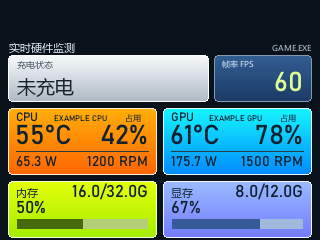
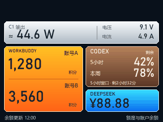
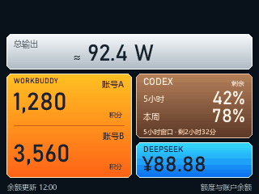

# 酷态科 AP01 工作台（cuktech-ap01-workbench）

## 致谢：首先感谢上游作者

### 一切的起点：slepher

**本项目最该感谢的是 slepher（GitHub：[@slepher](https://github.com/slepher)）。**
没有他在真机上一次一次试、并且把过程原原本本写下来，就不会有这个仓库。

- 主仓库：<https://github.com/slepher/cuktech-ap01-firmware>
- 🔴 **最关键的工作日志**：
  <https://github.com/slepher/cuktech-ap01-firmware/blob/master/project-workflow/ap01-app-update/status.md>
- 应用仓库：<https://github.com/slepher/codex_status>

这份 `status.md` 是**倒序流水账**——最新状态写在文件最开头，很容易只读到中后段
就以为「还没实机验证」。里面逐条记着：10 月 18 日首次实机安装、
10 月 19 日白天真机刷入 0041 自定义 ROM、深夜用
`miIO.recovery({"module":"app"})` 配合原版固件把设备降回 `1.0.2_0031`、
11 月 5 日双槽部署并装上 Codex 额度应用、11 月 6 日还在修 UI 与启动延迟，
连「用户确认画面正常」「未提交」这种细节都留着。

🔴 **本项目 0041 → 0031 的整条降级路线，就是几天前逐条分析这份日志后研判出来的**：
原厂恢复通道不查小米 PKI 签名、写命令只发一次、设备空闲后补一次 recovery、
验收只看版本和 `life` 不看 RPC 回执。这些结论后来都在我们自己的真机上验证过，
但**路是他先走出来的**。

### 最早把「自定义画面 + AI 额度」做成可用工具的两位

- **wqytommy666 / cuktech-screen-controller**（2026-07-16 建仓，时间上最早）
  <https://github.com/wqytommy666/cuktech-screen-controller>
  自定义图片与 GIF、Claude/Codex 实时额度、Wi-Fi 局域网刷新、RAM 更新。
  「把这块屏当账户工作台」这个用法，就是他先做出来的。
  他的兼容文档也是最早写清「只支持 0031、0041 直接拦」的第一手依据。

- **XiaoTianWork / cuktech-ap01-screen-kit**（2026-07-17 建仓）
  <https://github.com/XiaoTianWork/cuktech-ap01-screen-kit>
  RAM 加载器方案（固件槽 221,445 字节 / 加载器 256 KiB），
  最早把「不重刷整机、只换显示内容」这条路讲清楚。
  本项目前一版致谢漏了这一位，特此补上。

### 提供整套刷机工具链的人

- **andy / cuktech-ap01-firmware-tools**
  <https://github.com/andy-JustSayWhen/cuktech-ap01-firmware-tools>
  本项目的刷机流程、固件制作框架、小米云凭据读取和 HTTPS 固件服务，
  都建立在这个项目之上。没有它，降级和显示加载器都无从下手。

### 提供小米登录流程的人

- **Piotr Machowski / Xiaomi-cloud-tokens-extractor**
  <https://github.com/PiotrMachowski/Xiaomi-cloud-tokens-extractor>
  二维码登录与令牌提取流程。

还要感谢在这些仓库的 issue 里持续反馈、把失败案例也写下来的所有人——
本项目能少走弯路，靠的正是那些「没成功」的记录。

固件版权归**酷态科（CUKTECH）**所有，本仓库只做个人恢复与研究存档。
完整的引用、许可和免责声明见 [NOTICE.md](NOTICE.md)，第三方许可全文见
[THIRD_PARTY_LICENSES.md](THIRD_PARTY_LICENSES.md)。

## 这是什么

给一块 320×240 的酷态科 AP01 桌面小屏，装上自己想看的内容。同一块屏，
可以做两种完全不同的显示模式：

- **模式 A｜硬件监控台**：CPU/GPU 功率温度、占用、风扇转速、内存显存、
  游戏帧率、四个充电口的实时功率；
- **模式 B｜账户工作台**：Codex 额度与重置时间、WorkBuddy 两个账号积分、
  DeepSeek 余额、充电端口的电压电流。

**默认只需要一块屏。** 两种模式共用同一套 0031 固件、同一套降级流程，
区别只有三处：装哪个加载器、电脑上跑哪个服务、走哪个端口。
想从一种换到另一种，改一下配置、重启服务、重装加载器就行，
**不用再买设备，也不用重新降级**。

本仓库记录了完整改造过程：从原厂 `1.0.2_0041` 降到 `1.0.2_0031`、
装自定义显示加载器、在电脑上跑显示服务、把数据推到屏幕上。
所有关键结论都来自真机实测，失败路线也一并保留。

> 开发时手上有两块屏，所以两种模式是同时开着、各占一块对照调试的。
> 那只是为了省时间，**不是使用前提**。你有一块屏，就两种模式挨个试；
> 有两块屏，也可以一块一种，互不干扰。

> ⚠️ **先看风险**：刷机可能变砖、失去保修、触发账号风控。`1.0.2_0055`
> 是更高版本且不可逆，**不要**把它当成降级目标。详见
> [docs/03-0055-未知状态.md](docs/03-0055-未知状态.md) 和
> [docs/09-风险与未验证.md](docs/09-风险与未验证.md)。

## 最近更新（2026-11-10）

- **充电输出上屏**：只读小米云端口数据，用电压 × 电流估算功率并标注 `≈`；
  单口显示端口/功率/电压/电流，多口只显示总功率。读不到就写「不可用」，不填 0 W。
- **界面定稿**：银白金属充电卡与功率、电压电流合并为一卡；帧率卡归到 GPU 上方；
  CPU/GPU 增加真实风扇 RPM（不用控制百分比冒充）；128 色 Median Cut 渐变，
  GIF 稳定在 24572 字节上限内，5 秒过期判定没有放宽。
- **断网自恢复**：开机时服务可能早于 Wi-Fi 就绪而启动失败；加了每分钟端口守护，
  自动重试到网络就绪为止。实测人为停掉两个服务后 1 分钟内恢复。
  脚本见 `tools/screen_service_watchdog.py`。
- **宣传物料**：52 秒横版宣传片三版与社交媒体 5 图、两版文案，生成工程在 `video/`。

完整数据、演练时间线和未覆盖范围见
[docs/13-1110-稳定性与界面定稿.md](docs/13-1110-稳定性与界面定稿.md)。

## 一块屏，两种模式

| | 模式 A · 硬件监控台 | 模式 B · 账户工作台 |
|---|---|---|
| 屏幕上显示 | CPU/GPU 功率、温度、占用、风扇转速；内存、显存；游戏 FPS；C1/C2/C3/USB-A 充电数据 | WorkBuddy 两个账号积分；Codex 5 小时/本周剩余额度与重置时间；DeepSeek 人民币余额；充电端口、功率、电压、电流 |
| 电脑上跑 | `tools/hardware_monitor/runtime.py`，端口 `18765` | `tools/display_service.py`，端口 `18766` |
| 屏里装 | `加载器_0031_18765_硬件监测.bin` | `加载器_0031_18766_账户余额.bin` |
| 额外依赖 | MSI Afterburner（带 RTSS），用来读传感器和帧率 | 无，装完 Python 包就能跑 |
| 适合谁 | 想知道电脑此刻在干什么、打游戏掉不掉帧 | 想随时看到几个 AI 账号还剩多少额度 |

**怎么换模式**（不用重新降级、不用重刷原厂固件）：

1. 把 `config.json` 里 `network.display_port` 改成对应端口（18765 或 18766）；
2. 停掉当前那个服务，启动另一个；
3. 把 `firmware.loader` 指向对应的加载器，跑一次 `install_loader.py`。

只有两种模式要**同时**显示，才需要第二块屏。这时候两台设备各填各的 DID、
各占一个端口、各用一份事务文件，其余流程完全一样，见
[docs/07-一块屏的两种模式.md](docs/07-一块屏的两种模式.md)。

**模式 A · 硬件监控台（截图使用示例数据）**



**模式 B · 账户工作台（截图使用示例数据）**



模式 B 还支持多口同时输出和整块数据不可用两种状态：

| 多口同时充电 | 数据源全部不可用 |
|---|---|
|  |  |

两种模式的详细能力和实测边界见 [docs/07-一块屏的两种模式.md](docs/07-一块屏的两种模式.md)，
模式 A 的传感器怎么接、每个数字从哪来见 [docs/12-硬件监测模式.md](docs/12-硬件监测模式.md)。

---

## 三条关键结论（先看，能省几天）

1. **0041 可以降回 0031。** 钥匙不是找到隐藏命令，而是把固件首字节从
   `0x42` 预反转成 `0xBD`。0041 的写入器接收时会再取反一次，正好还原；
   直接发原版 0031 反而会留下坏镜像。
2. **0055 不是降级目标。** 它是比 0041 更高的版本，签名闸门更严，
   目前没有任何真机证据能降回来。本仓库只写风险，不提供刷 0055 的步骤。
3. **屏幕显示慢，通常不是取数慢。** 真正的链路是
   `功率 5 秒采样 → 画面 60 秒生成 → 设备 60 秒取图`。
   把最后两段改成一条 300 帧、每秒一块的长连接，端到端才降到 1～6 秒。

---

## 这套东西由什么组成

```
┌──────────────┐    HTTPS 固件（只允许屏幕 IP）   ┌──────────────┐
│ Windows 电脑  │ ───────────────────────────────► │ AP01 屏幕     │
│              │                                  │ 0031 + 加载器 │
│ 显示服务      │ ◄──── /live.bin 每秒取一张 ───── │              │
│ 18765/18766  │      300 块 × 24576 字节          └──────────────┘
└──────┬───────┘
       │ 只读
       ├── Codex app-server（额度）
       ├── WorkBuddy 本机快照（两个账号积分）
       ├── DeepSeek 余额接口（DPAPI 加密密钥）
       └── 小米云 RPC（充电功率 siid=4）
```

- **降级器**：`tools/downgrade_0041_to_0031.py`，首字节预反转 + 只发一次写命令。
- **救机/回原厂**：`tools/restore_factory.py`，默认 dry-run，一次只碰一台。
- **加载器安装**：`tools/install_loader.py`，核对 DID、型号、版本、IP、路由、GIF。
- **账户工作台模式显示服务**：`tools/display_service.py`，同时提供 `/screen.gif` 和 `/live.bin`。
- **硬件监测模式监测服务**：`tools/hardware_monitor/`，读真实传感器 + 真实帧事件，画 320×240 面板。
- **功率读取**：`tools/power_reader.py`，5 秒采样，读失败不写假 0。
- **固件补丁**：`tools/patch_firmware.py`，首字节反转、等长 URL 替换、CRC 重算。

---

## 快速开始

整条链路有严格顺序：**先查设备状态 → 起电脑上的服务 → 再让屏幕去连它。**
装加载器那一步会拿电脑的服务做验证，服务没起就一定过不去。

> 命令按 Windows 的 `cmd` 写。用 PowerShell 把 `copy` 换成 `Copy-Item`，
> Git Bash 换成 `cp`；`docs/` 里带 `\` 续行的命令在 `cmd` 里要换成 `^`。
> **第 2 步降级要用管理员身份开终端**（要临时占用 443 端口）。

### 0. 准备

- Windows 10/11 + Python 3.10 以上（模式 A 的硬件采集只能在 Windows 上跑）
- **一块**已经在米家里绑定、在线的 AP01
- 屏幕和电脑同局域网，电脑 IP 固定不变（路由器里做静态绑定）
- 选模式 A 的话，再装一个 **MSI Afterburner**（自带 RTSS）
- 克隆上游工具，扫码登录一次：

```bash
git clone https://github.com/andy-JustSayWhen/cuktech-ap01-firmware-tools.git
cd cuktech-ap01-firmware-tools
python -m pip install -r requirements.txt
python app/ap01_official_firmware.py login
```

最后一条会打印一张二维码图片的路径，用**绑定了这块屏的那个米家账号**
扫码并确认，登录态写进上游仓库的 `env/mi-cloud.env`。
本仓库不保存你的账号密码，也不会把那个文件传到网上。

### 1. 装本仓库 + 选模式

```bash
git clone https://github.com/interli3/cuktech-ap01-workbench.git
cd cuktech-ap01-workbench
python -m pip install -r requirements.txt
copy config.example.json config.json
```

打开 `config.json`，这五处必须改成你自己的：

| 字段 | 填什么 |
|---|---|
| `device.did` | 这块屏的 DID（纯数字，第 2 步的体检命令会告诉你） |
| `device.device_ip` | 这块屏在局域网的 IP |
| `network.bind` | **你电脑**的局域网 IP。必须填真实地址，不要填 `0.0.0.0`：装加载器时脚本要用它生成「设备来下载固件」的地址 |
| `upstream.repo` | 上游 `cuktech-ap01-firmware-tools` 在你电脑上的绝对路径 |
| `allowed_dids` | 把示例 DID 换成你自己的；回原厂脚本只认这个白名单 |

> 🔴 **地址三处必须一致，这是最容易漏的一步**：
> 预编译加载器里写死的是 `http://192.168.1.160:<端口>/live.bin`。
> 二选一：
>
> 1. **推荐**：在路由器里把电脑固定为 `192.168.1.160`，什么都不用改；
> 2. 改加载器里的地址（**新旧地址长度必须完全相同**，否则只能重新编译加载器）：
>
> ```bash
> python tools/patch_firmware.py patch-url --in firmware/加载器_0031_18766_账户余额.bin --out build/loader.bin --old http://192.168.1.160:18766/live.bin --new http://192.168.1.101:18766/live.bin
> ```
>
> 命令会打印新固件的 SHA256。**把这串值填回 `config.json` 的
> `firmware.loader_sha256`**，并把 `firmware.loader` 指向新文件，
> 否则第 4 步安装脚本按哈希校验会直接拒绝。`config.json` 的 `network.bind`
> 填同一个电脑 IP。示例里的 `192.168.1.101` 请换成你自己电脑的地址，
> 位数必须和 `192.168.1.160` 一样。

**顺便在这里选好模式**（样例配置默认是模式 B）：

| 想用 | 改这两处 |
|---|---|
| 模式 A 硬件监控台 | `hardware.port` 用 `18765`；`firmware.loader` 指向 `firmware/加载器_0031_18765_硬件监测.bin` |
| 模式 B 账户工作台 | `network.display_port` 用 `18766`；`firmware.loader` 指向 `firmware/加载器_0031_18766_账户余额.bin` |

只做一种就只管一种，另一套不用碰。以后想换模式不用重做第 2 步。

### 2. 先体检，再降级（0041 → 0031）

不管降不降级，先跑这条**只读**命令，它不会写设备：

```bash
python tools/check_device.py
```

它会列出账号里每台 AP01 的 DID、局域网 IP、固件版本、运行秒数和 OTA 状态，
并直接告诉你下一步：

- `1.0.2_0041` 且 `OTA=['idle']` → 可以降级，往下做；
- `1.0.2_0031` → **跳过降级**，直接进第 3 步；
- `1.0.2_0055` → 停，本仓库没有可用路线，见 [docs/03-0055-未知状态.md](docs/03-0055-未知状态.md)。

把输出里的 DID 和 IP 填回 `config.json`，再继续。

降级用的传输固件仓库里已经放好：`firmware/降级用_0031_首字节预反转.bin`。
想自己复现一遍确认没被换过（建议做）：

```bash
python tools/patch_firmware.py preinvert --in firmware/原厂_0031.bin --out build/0031-transport.bin
```

输出里的 SHA256 应该是 `828adbb3ba6087765e9888f40c42177104b4a327088d8e9a2847a35ee61b48de`，
和仓库里那个文件一致。这一步只是验算，`build/` 下的产物不会被降级脚本读取。

```bash
python tools/downgrade_0041_to_0031.py            # 先看计划，不碰设备
python tools/downgrade_0041_to_0031.py --execute-once
```

**怎么算成功**：再跑一次 `python tools/check_device.py`，看到 `固件 1.0.2_0031`、
`life` 是个小数字且隔一分钟再查会变大，就是真的重启过了。
**不要看命令回执**，它不实话。中途设备离线几十秒是正常的，别断电、别重发。

完整判据、时间线、失败处理和事务文件位置见
[docs/02-降级-0041到0031.md](docs/02-降级-0041到0031.md)。

### 3. 起你选的那个显示服务（必须在装加载器之前）

模式 B（账户工作台，端口 18766）：

```bash
python tools/display_service.py
```

模式 A（硬件监控台，端口 18765）：

```bash
python tools/hardware_monitor/runtime.py
```

一块屏只需要跑其中一个。起来之后先在**同一台电脑的浏览器**里确认：

- `http://电脑IP:18766/health` → 返回 JSON，`ok` 是 `true`
- `http://电脑IP:18766/screen.gif` → 能看到一张 GIF 图

模式 A 把端口换成 `18765` 同样验证一遍。模式 A 第一次跑会先黑 2～3 秒
（在打开传感器库），属于正常。

> 模式 B 第一次跑，「Codex / WorkBuddy / DeepSeek」那几块大概率显示「不可用」，
> 因为还没配数据源。这是正常的——先把图跑出来，数据源见
> [docs/06-电脑端显示服务.md](docs/06-电脑端显示服务.md)，配好再重启服务。

浏览器能打开、屏幕打不开 → 是防火墙没放行，先解决防火墙，不要重刷设备。

### 4. 装显示加载器

```bash
python tools/install_loader.py             # 离线检查，不写设备
python tools/install_loader.py --execute-once
```

这一步会真的去请求第 3 步的两个地址，核对 DID、型号、版本、IP、路由和 GIF，
任何一项不对就拒绝安装——这就是第 3 步必须先做的原因。
加载器只认 `njcuk.enstor.ap01 / 1.0.2_0031`，装错版本会被拒绝。

装完屏幕会重启，等 10～30 秒出画面。协议和端口改法见
[docs/05-显示加载器与传图协议.md](docs/05-显示加载器与传图协议.md)。

### 5. 配开机自启

用「任务计划程序」建一个**登录时触发**的任务，程序填 `pythonw.exe`，
参数填 `tools/display_service.py`（硬件监测模式填 `tools/hardware_monitor/runtime.py`），
起始目录填仓库根目录。

不要用「系统服务」方式——DeepSeek 的密钥用 DPAPI 加密，绑的是当前登录用户，
服务账户读不出来。

**再加一层守护（建议）**：登录时服务可能早于 Wi-Fi 就绪，绑定局域网地址会报
`WinError 10049` 并退出。建一个每分钟触发的任务，用 `pythonw.exe` 跑
`tools/screen_service_watchdog.py`，端口掉了就重启对应任务，网络一就绪就自动恢复：

```
pythonw.exe tools/screen_service_watchdog.py --service 18765=你的模式A任务名 --service 18766=你的模式B任务名
```

只跑一种模式就只填一个 `--service`。守护用 `127.0.0.1` 探活，路由器短时离线
不会被误判。详见 [docs/13-1110-稳定性与界面定稿.md](docs/13-1110-稳定性与界面定稿.md) 第 4 节。

---

## 仓库结构

```
cuktech-ap01-workbench/
├── README.md                 本文件
├── NOTICE.md                 上游引用、固件归属、免责声明
├── LICENSE                   MIT（仅覆盖本仓库代码）
├── config.example.json       配置样例
├── requirements.txt
├── .gitignore             本地配置不提交
├── firmware/                 原厂与改好的固件 + SHA256SUMS.txt
├── images/                   两种模式的截图
├── video/                    B 站宣传视频的生成工程（见 video/README.md）
├── tools/
│   ├── ap01_config.py        所有脚本共用的配置读取
│   ├── check_device.py       只读体检：查版本/DID/能不能降级
│   ├── patch_firmware.py     首字节反转 / 等长 URL 替换 / CRC 重算 / 校验
│   ├── downgrade_0041_to_0031.py
│   ├── install_loader.py
│   ├── restore_factory.py
│   ├── power_reader.py
│   ├── credentials.py        DeepSeek 密钥（DPAPI 加密存本机）
│   ├── display_service.py    模式 B：额度/余额/充电
│   ├── screen_service_watchdog.py  每分钟探活，端口掉了重启对应计划任务
│   └── hardware_monitor/     模式 A：CPU/GPU/内存/帧率/充电
│       ├── runtime.py        入口，起 HTTP 服务
│       ├── collector.py      读传感器
│       ├── cpu_sensor.ps1    常驻 PowerShell，读 CPU 功耗/温度/风扇
│       ├── charging.py       只读充电数据
│       └── dashboard.py      画 320×240 面板
└── docs/
    ├── 01-原理-固件与写入器.md
    ├── 02-降级-0041到0031.md
    ├── 03-0055-未知状态.md
    ├── 04-救机与回原厂.md
    ├── 05-显示加载器与传图协议.md
    ├── 06-电脑端显示服务.md
    ├── 07-一块屏的两种模式.md
    ├── 08-功率读取.md
    ├── 09-风险与未验证.md
    ├── 10-常见问题.md
    ├── 12-硬件监测模式.md
    └── 13-1110-稳定性与界面定稿.md
```

> 📌 预编译加载器里的电脑地址是 `192.168.1.160`。如果你的电脑不是这个地址，
> 先把电脑设成这个静态 IP，或用 `tools/patch_firmware.py patch-url` 换成等长地址。
> 地址长度不同时不能等长替换，需要重新编译加载器。

## 固件与校验

`firmware/` 里放了 8 个文件，全部可以用一条命令校验：

```bash
python tools/patch_firmware.py verify --dir firmware
```

| 文件 | 用途 |
|---|---|
| `原厂_0031.bin` | 厂家原版 0031，恢复主文件 |
| `原厂_0041.bin` | 厂家原版 0041，留档比对 |
| `原厂_0055.bin` | 厂家原版 0055，只做研究，不要刷 |
| `降级用_0031_首字节预反转.bin` | 0041 → 0031 的传输文件 |
| `加载器_0031_18765_硬件监测.bin` | 模式 A 300 帧长连接，端口 18765 |
| `加载器_0031_18766_账户余额.bin` | 模式 B 300 帧长连接，端口 18766 |
| `备用_0031_60秒取图.bin` | 60 秒取图旧版，备用 |
| `备用_18766_60秒取图.bin` | 60 秒取图旧版（模式 B），备用 |

## 隐私与脱敏

**仓库里没有这些东西**（已逐字节扫过全部文件 + 全部提交历史）：

- DeepSeek 或任何 API 密钥。密钥用 Windows 的加密接口存在你自己电脑的
  `run/deepseek_key.bin`，只有当前登录用户能解开，从不进仓库；
- 米家账号密码、登录态。`env/mi-cloud.env` 留在上游仓库里，
  被它自己的忽略规则挡住，本仓库既不读取内容也不上传；
- 设备的真实 DID。配置样例里是 `1234567890` / `0987654321` 两个假值；
- 真实账号名、真实积分、真实余额、真实额度。截图和 GIF 里每一帧的账号名
  都已换成「账号A / 账号B」，数字也全是示例值；
- 你电脑上的绝对路径、Windows 用户名、邮箱、手机号。

**仓库里确实还有地址，说清楚是什么**：

- `192.168.1.160` 出现在文档和 4 个加载器固件里。这是**私有内网地址**
  （`192.168.x.x` 只在你的路由器里有效，公网访问不到），不是公网 IP。
  它写死在固件里是技术需要——设备得知道去哪台电脑取图，删掉固件就不能用了。
  你可以用 `patch_firmware.py patch-url` 换成自己电脑的等长地址，
  或者把电脑设成这个静态 IP；
- `config.example.json` 里的 `192.168.1.50` 是随便写的示例设备 IP，
  你填的时候换成自己的；
- `127.0.0.1` 是每台电脑都一样的本机地址，不涉及任何人；
- 原厂固件二进制里有一个 `@xiaomi.com` 邮箱字符串，那是**酷态科打包时自带的
  厂商信息**，既不是你的也不是本仓库作者的，无法也不需要从固件里剔除。

`config.json`、`run/`、`runtime/`、`build/` 都在 `.gitignore` 里，不会被提交。

## 宣传视频

仓库里的 `video/` 是 B 站宣传片的完整生成工程：52 秒，1080p，中文旁白 + 配乐。
屏幕画面不是把小截图放大，而是照着本仓库的绘制代码重绘成 4 倍分辨率，
所以放大后依然清晰。详见 [video/README.md](video/README.md)。

## 边界

- 没有逐一验证所有游戏；FPS 采集依赖 PresentMon，反作弊/渲染 API 可能有差异。
- C3、USB-A、多口功率做过代码和渲染测试，没有逐口插手机完成真机验收。
- 11-10 已实测：断网后开机、两个服务被人为停止后 1 分钟内自动恢复。
  **仍未覆盖**整晚/跨天连续运行、电脑完整重启后的真实登录触发、睡眠唤醒、
  Wi-Fi 切换与 DHCP 地址改变后的两屏回归。
- 电脑地址由路由器动态分配时，**在路由器里给网卡做 DHCP 固定租约**，
  不要直接在 Windows 上写静态地址（可能与地址池冲突）。换了地址先改配置，不要重刷。
- 设备不要在米家里升级到 0055。

## 许可

本仓库代码使用 MIT License。固件版权归酷态科，引用项目各有自己的 MIT 许可，
详见 [NOTICE.md](NOTICE.md)。
