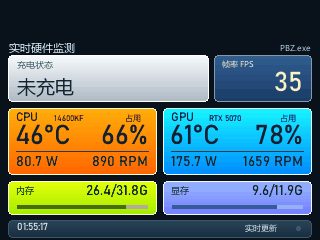
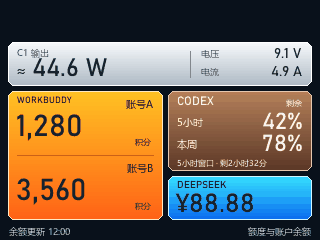
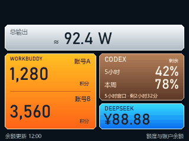

# 07 一块屏的两种模式

**默认只需要一块 AP01。** 同一块屏，装不同的加载器、连不同的电脑端口，
就能显示完全不同的两套内容。本文把两种模式能干什么、怎么换、边界在哪讲清楚。

> 项目开发时手上有两块屏，所以两种模式是同时开着对照调试的。
> 那只是为了省时间，不是使用前提。你有一块屏就挨个试；
> 想同时看两种，才需要第二块屏（第 5 节）。

## 1. 一张表看懂

| 能力 | 模式 A · 硬件监控台 | 模式 B · 账户工作台 |
|---|---|---|
| CPU 功率 | ✅ | — |
| CPU 温度 | ✅ | — |
| CPU 占用 | ✅ | — |
| CPU 风扇转速（真实 RPM） | ✅ | — |
| GPU 功率/温度/占用 | ✅ | — |
| 显存已用/总量 | ✅ | — |
| 内存已用/总量 | ✅ | — |
| 游戏 FPS | ✅（PresentMon 自动识别） | — |
| C1/C2/C3/USB-A 充电数据 | ✅ | ✅ |
| 单口显示功率/V/A | ✅ | ✅ |
| 多口只显示总功率 | ✅ | ✅ |
| WorkBuddy 两个账号积分 | — | ✅ |
| Codex 5 小时/本周剩余额度 | — | ✅ |
| Codex 重置剩余时间 | — | ✅ |
| DeepSeek 人民币余额 | — | ✅ |
| 数据不可用提示 | ✅ | ✅ |

## 2. 怎么在两种模式之间换

两种模式共用**同一套 0031 固件和同一套降级流程**。换模式不需要重新降级、
不需要回原厂、不需要再买设备，只要动三处：

| 步骤 | 模式 A 硬件监控台 | 模式 B 账户工作台 |
|---|---|---|
| ① `config.json` 的端口 | `hardware.port = 18765` | `network.display_port = 18766` |
| ② `firmware.loader` | `firmware/加载器_0031_18765_硬件监测.bin` | `firmware/加载器_0031_18766_账户余额.bin` |
| ③ 电脑上起的服务 | `python tools/hardware_monitor/runtime.py` | `python tools/display_service.py` |

顺序：先改配置 → 停掉旧服务、起新服务 → 浏览器确认 `/health` 和 `/screen.gif`
都正常 → 再跑一次 `python tools/install_loader.py --execute-once` 装对应的加载器。

⚠️ 加载器里写死了端口，所以**端口和加载器必须配对**，不能一个用 18765 的加载器、
另一个跑 18766 的服务。两个文件只差端口和 4 字节校验，别拿混。

## 3. 模式 A · 硬件监控台

屏幕上从上到下：

- 顶部标题「实时硬件监测」，右上角是当前前台进程名（示例里是游戏）；
- 顶部中间：充电状态卡，单口显示功率/电压/电流，多口显示总功率；
- 中间左：CPU 温度、占用、功率、风扇 RPM；
- 中间右：GPU 温度、占用、功率、风扇 RPM；
- 下面：内存、显存；
- 右上：帧率；
- 底部：时间和刷新状态。

### 它适合干什么

- 打游戏时看 CPU/GPU 有没有降频、温度是否过高、风扇是否转；
- 看当前游戏的真实 FPS，而不是驱动/ overlays 的估算；
- 看充电器每个口在给什么设备供电、功率多少；
- 放在桌面上当一个小型状态屏。

### 它的数据口径

- CPU 功率/温度：LibreHardwareMonitor，一个常驻辅助进程持续输出；
- CPU 占用：Windows `% Processor Utility`；
- CPU 风扇：主板 Super I/O 的 `CPU Fan` 实际 RPM，不是「风扇控制百分比」；
- GPU：NVIDIA NVML，功率/温度/显存/风扇 RPM；
- GPU 占用：Windows GPU Engine 里按进程汇总的 3D 最忙引擎，
  不把「驱动忙碌率」混进来；
- FPS：PresentMon 的实际 Present 事件，没有有效游戏帧时显示等待，
  不固定显示 60，也不拿桌面窗口冒充游戏。

每个数字具体从哪个接口来、怎么自己测一遍，见
[12-硬件监测模式.md](12-硬件监测模式.md)。

### 它不能干什么

- 不能显示账户余额；
- 不能在没有 NVIDIA 显卡的机器上读 GPU 数据（NVML 依赖）；
- 不能保证所有游戏/反作弊都兼容 PresentMon。

## 4. 模式 B · 账户工作台

屏幕上从上到下：

- 顶部：充电输出卡（银白渐变），单口显示端口名、约算功率、电压、电流；
- 左侧一整块橙金卡：WorkBuddy 两个账号，上面是账号 A，下面是账号 B，
  共用一个外框，中间一条细线；
- 右上咖啡色卡：Codex，5 小时窗口和本周窗口的剩余百分比，
  底部是 5 小时窗口的重置倒计时；
- 右下青蓝卡：DeepSeek 人民币余额；
- 底部：余额更新时间和「额度与账户余额」。

### 多口和不可用状态

| 多口同时输出 | 数据源全部不可用 |
|---|---|
|  |  |

- 只有一个口有输出：显示端口名、`≈功率`、电压、电流；
- 多个口有输出：只显示总功率，不显示单口细节；
- 四个口都 0A 且读取成功：显示「未充电」；
- 云端读取失败/样本超过 15 秒：显示「数据暂不可用」，不写假 0。

### 它适合干什么

- 随时看两个 WorkBuddy 账号还剩多少积分；
- 看 Codex 5 小时/本周额度，避免写到一半被限流；
- 看 DeepSeek 余额，知道还能跑多久；
- 顺便当充电器的功率表。

### 它不能干什么

- 不能显示 CPU/GPU/内存/FPS；
- 不能替代原厂功率页的全部细节（协议档位、历史曲线等）；
- 余额依赖本机服务，电脑关机/未登录就没有数据。

## 5. 可选：多块屏同时各跑一种

只有你想**同时**看到两种内容，才需要第二块屏。这时候每台设备各填各的 DID、
各占一个端口、各用一份事务文件：

| 项目 | 屏幕 1 跑模式 A | 屏幕 2 跑模式 B |
|---|---|---|
| DID | 设备 A | 设备 B |
| 屏幕 IP | 固定 | 固定 |
| 电脑端口 | 18765 | 18766 |
| 显示服务 | `tools/hardware_monitor/runtime.py` | `tools/display_service.py` |
| 加载器 | `加载器_0031_18765_硬件监测.bin` | `加载器_0031_18766_账户余额.bin` |

隔离规则：

1. **DID 不能混。** 每个脚本只认配置里的一个 DID；
2. **端口不能混。** 模式 A 用 18765，模式 B 用 18766；
3. **事务文件不能混。** 每次写设备用独立目录；
4. **一次只刷一台。** 另一台只读复验，不参与写入；
5. **防火墙只放行对应屏幕 IP。**

满足这五条，多台设备可以同时在线、同时刷新，不会互相抢端口或误刷。

## 6. 实测边界

- 模式 A 的界面经过多轮迭代，本机确认好用；
- 模式 B 的颜色和功率响应经过拔插充电线验收；
- C3、USB-A、多口只做过代码/渲染测试，没有逐口插手机完成真机验收；
- 没有做整机重启、睡眠唤醒、路由器重启后的多设备回归；
- 没有逐一验证所有游戏。

这些不影响「能用」，但别人复现时要知道边界在哪。
